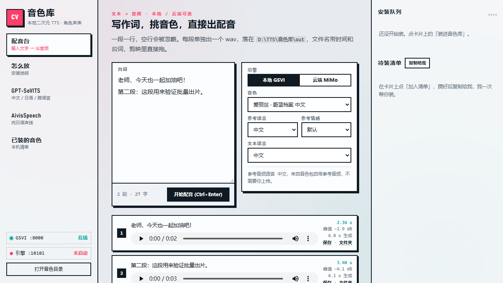
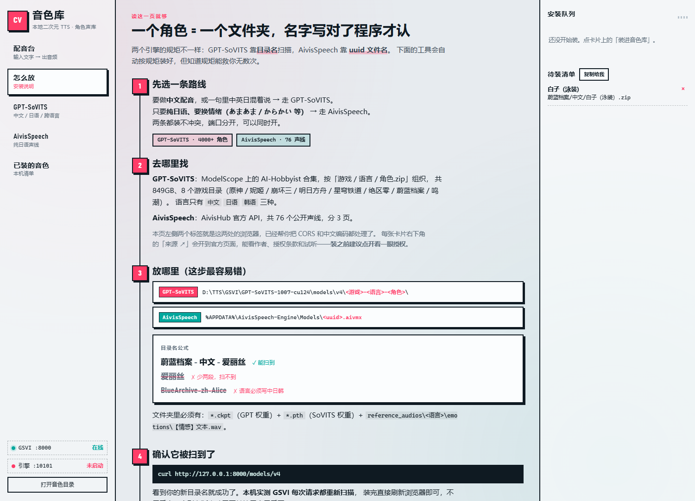
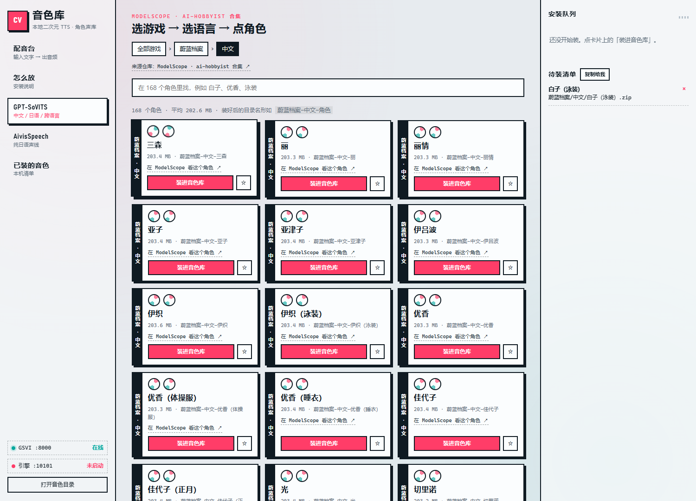
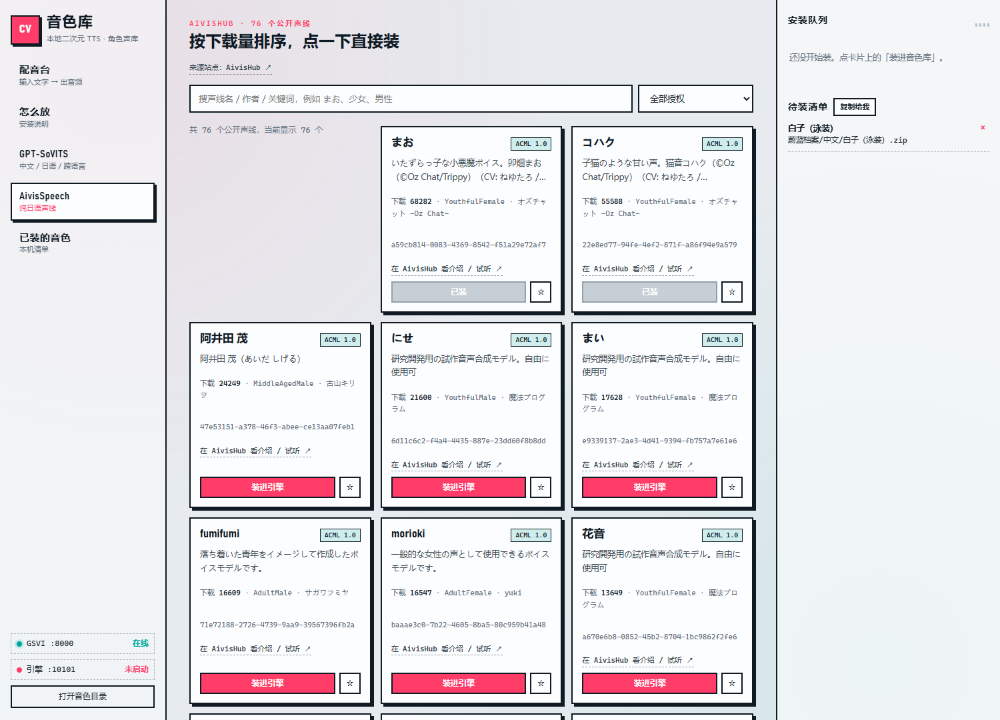
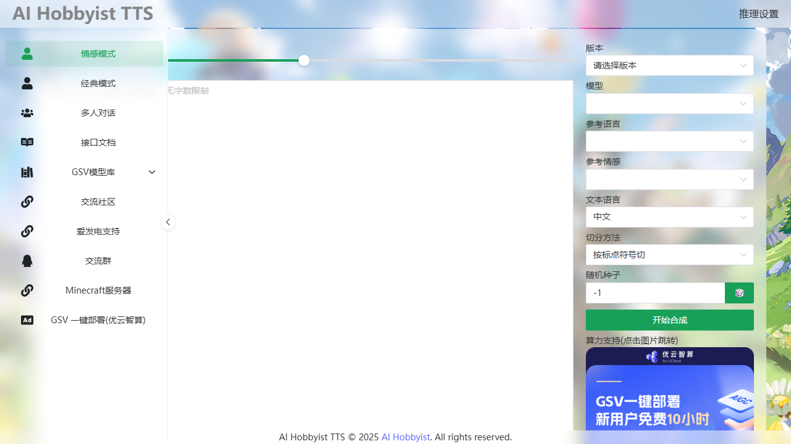

# 本地二次元 TTS 配音环境 · 使用说明

> 全部推理在本机完成，文本与音频不出本地网络（除首次安装下载模型）。
> 安装根目录：`D:\TTS`

---

## 一、装了什么、在哪

| 组件 | 位置 | 占用 | 作用 |
|---|---|---|---|
| GPT-SoVITS 推理特化包（GSVI） | `D:\TTS\GSVI\GPT-SoVITS-1007-cu124` | 13.7 GB（65088 个文件） | 主力方案：中文 + 日语 + 跨语言，自带 Python/PyTorch/CUDA 运行时，无需另装环境 |
| AivisSpeech（编辑器 + 引擎） | `D:\TTS\AivisSpeech` | 0.94 GB | 纯日语动漫声线，VOICEVOX 兼容 API |
| AivisSpeech 声线与 BERT 缓存 | `%APPDATA%\AivisSpeech-Engine\`（C 盘） | 1.85 GB | `Models\*.aivmx`（0.48GB）+ `BertModelCaches\`（1.3GB） |
| 音色（3 个） | `GSVI\GPT-SoVITS-1007-cu124\models\v4\` | 0.62 GB | 爱丽丝 中/日 + 白子 中文，见下方目录结构 |
| 音色库工具（自己加的） | `D:\TTS\音色库`（产物在 `out\`） | 70 KB | 配音台（本地 GSVI / 云端 MiMo 双引擎）+ 音色搜索与安装，见第二、三节 |
| 安装包留档 | `D:\TTS\_packages` | 0 GB | 安装验收后已清理（释放 8.07 GB）；重装见文末下载地址 |
| 启动脚本 | `D:\TTS\1-启动GPT-SoVITS配音.bat`<br>`D:\TTS\2-启动AivisSpeech日语配音.bat`<br>`D:\TTS\3-打开音色库.bat` | — | 双击即用 |

本机硬件：**NVIDIA RTX 3080 10GB / 驱动 591.74**（≥551，支持 CUDA 12.4）。
两个服务同时开启时整卡显存占用约 **6.7 GB / 10 GB**（含桌面程序），可并行运行。

### 音色目录结构（命名是硬性规则，改了扫不到）

```
GSVI\GPT-SoVITS-1007-cu124\models\v4\
├─ 蔚蓝档案-中文-爱丽丝\          ← 游戏-语言-角色名
│   ├─ 爱丽丝-e10.ckpt           ← GPT 权重
│   ├─ 爱丽丝_e10_s150_l32.pth   ← SoVITS 权重
│   └─ reference_audios\中文\emotions\【默认】....wav
├─ 蔚蓝档案-日语-爱丽丝\
│   └─ reference_audios\日语\emotions\【默认】....wav
└─ 蔚蓝档案-中文-白子\            ← 用音色库工具装的（2026-10-29 实测）
    └─ reference_audios\中文\emotions\【默认】....wav
```

---

## 二、怎么启动

### 1）GPT-SoVITS（中文 / 日语 / 跨语言）
双击 `D:\TTS\1-启动GPT-SoVITS配音.bat`
- 内部：`cd` 到 `GSVI\GPT-SoVITS-1007-cu124` → 12 秒后自动打开浏览器 → `call gsvi.bat`
- Web UI：<http://127.0.0.1:8000>
- API：`http://127.0.0.1:8000/infer_single`
- **关闭那个黑窗口 = 停止服务**

### 2）AivisSpeech（纯日语）
双击 `D:\TTS\2-启动AivisSpeech日语配音.bat`
- 内部：`set HF_ENDPOINT=https://hf-mirror.com` → 启动 `AivisSpeech.exe`
- 编辑器会**自动拉起引擎**（`run.exe`，端口 10101），无需另开
- 只用接口、不开编辑器时：
  ```
  cd /d D:\TTS\AivisSpeech\AivisSpeech-Engine
  set HF_ENDPOINT=https://hf-mirror.com
  run.exe --host 127.0.0.1 --port 10101 --use_gpu
  ```

### 3）配音台（输入文字直接出音频）
双击 `D:\TTS\3-打开音色库.bat`，**打开就是「配音台」**
- 引擎二选一：**本地 GSVI**（默认）/ **云端 MiMo**
- 本地：选音色 → 参考语言/情感自动跟出来 → 写台词 → `Ctrl+Enter`（或点按钮）
- 云端：选预置音色（冰糖/茉莉/苏打/白桦 + 英文 4 个）→ 写**风格指令** → 写台词
- **一段一行**，空行忽略；每段单独出一个 wav，全部落在 `D:\TTS\音色库\out\`
  文件名 = `时间_角色_台词前14字.wav`，剪映里直接拖
- 每段下面显示 **时长 / 峰值 dB / 生成耗时**，可试听、保存、打开所在文件夹
- 峰值低于 -25 dB 会标「偏静」——大概率是文本语言选错了，别当成功
- 失败时**红卡片里直接写原因**（不再只显示"失败"）

实测（同一句「重要的的台词有地方可找」）：

| 引擎 | 输出 | 耗时 | 峰值 |
|---|---|---|---|
| 本地 爱丽丝 | 2.52 s / 48 kHz | 12.6 s | -3.1 dB |
| 云端 MiMo 冰糖 | 2.88 s / 24 kHz | **2.5 s** | -4.4 dB |

**端口**：默认 8899；**被别的程序占用时自动换 8900~8910**，具体地址看黑窗口第一行
（`音色库服务: http://127.0.0.1:89xx`），浏览器也会自动打开那个地址。



不想开网页也行，直接打接口（同一台机器）：
```
POST http://127.0.0.1:8899/api/tts/say
{"voice":"蔚蓝档案-中文-爱丽丝","promptLang":"中文","emotion":"默认","textLang":"中文","text":"要说的台词"}
→ {"msg":"合成成功","file":"...wav","duration":3.76,"peakDb":-6.8,...}
```

### 4）音色库（找角色 / 装音色）
双击 `D:\TTS\3-打开音色库.bat`
- 地址：<http://127.0.0.1:8899>（**这个只是找音色用的工具，不参与合成，关掉不影响配音**）
- 「怎么放」标签是图文说明；另外两个标签分别是 ModelScope 角色库和 AivisHub 声线库
- 点卡片上的「装进音色库」→ 自动下载、按 GBK 解压、重命名成 `游戏-语言-角色`、落到 `models\v4`
- **每张卡都有「来源 ↗」**：新标签打开官方页面，能看作者、授权条款、试听（AivisHub 有试听，ModelScope 是文件页）
  - GPT-SoVITS → `modelscope.cn/models/aihobbyist/GPT-SoVITS_Model_Collection/file/view/master/<路径>`
  - AivisSpeech → `hub.aivis-project.com/aivm-models/<uuid>`
  - 页头还有「来源仓库 / 来源站点」直达合集首页
- 「加入清单」攒几条，点「复制给我」把清单粘给我，我一次装完
- 关掉黑窗口 = 停止工具

| 说明页（怎么放） | 角色库（点一下装） | 声线库（AivisHub） |
|---|---|---|
|  |  |  |

### 5）用 ffmpeg 检查产物
```
ffprobe -v error -show_entries format=duration -of default=nw=1 your.wav
ffmpeg -hide_banner -nostats -i your.wav -af volumedetect -f null -
```
峰值 `max_volume` 落在 **-10dB ~ -1dB** 才算真出人声；-40dB 以下基本是空音频。

---

## 三、接口怎么调

### GPT-SoVITS：`POST http://127.0.0.1:8000/infer_single`

```json
{
  "version": "v4",
  "model_name": "蔚蓝档案-中文-爱丽丝",
  "prompt_text_lang": "中文",
  "emotion": "默认",
  "text": "老师，今天也一起加油吧！",
  "text_lang": "中文"
}
```
返回 `{"msg":"合成成功","audio_url":"http://0.0.0.0:8000/outputs/xxxx.wav"}`。
注意 `audio_url` 里的 `0.0.0.0` 要自己换成 `127.0.0.1` 才能下载；音频实际落在
`GSVI\GPT-SoVITS-1007-cu124\outputs\`。

### 语言参数合法值（写错直接报参数错误）

```
中文  英语  日语  粤语  韩语  中英混合  日英混合  粤英混合  韩英混合  多语种混合
```
- 是「日语」不是「日文」。
- `prompt_text_lang` = 参考音频的语言，必须与音色目录里 `reference_audios\<语言>\` 一致；
  `text_lang` = 要合成的文本语言。
- **跨语言**：日语音色 + `text_lang: "中文"` + 中文文本，实测可用（见验收表第 4 行）。

### 三个模式的区别（为什么有的页面要你上传参考音频）

GPT-SoVITS 是**零样本克隆**模型：`.ckpt` / `.pth` 只决定"这是谁的声音"，
每一句的**语气、音高、节奏**还要靠一段 3~10 秒参考音频 + 它对应的文字来"定调"（这个组合叫 prompt）。
所以"有模型了还要参考音频"不是 bug，是这套架构的机制。

| 页面 | 参考音频从哪来 | 什么时候用 |
|---|---|---|
| **情感模式** `http://127.0.0.1:8000/`（推荐） | 音色包自带 `reference_audios\<语言>\emotions\【情感】文本.wav`，你只选情感 | 日常配音，**不用上传任何东西** |
| 经典模式 `/classic` | **你自己上传** ckpt + pth + 一段 wav + 它的文字 | 临时换参考音，或用没打包 `reference_audios` 的旧模型 |
| 多人对话 | 每行 `角色: 台词` | 一段对白里多个角色 |

本机三个音色都带 `reference_audios\中文\emotions\【默认】….wav`，文件名里
`【默认】` 是情感名、后面那串就是参考文本——程序自己解析，所以你只需要写台词。
那个"上传参考音频"的弹窗，是你点到了左侧的**经典模式**。

正确的页面（左侧选「情感模式」，只有文本 + 版本/模型/参考语言/参考情感/文本语言）：



### AivisSpeech（VOICEVOX 兼容，端口 10101）

```
GET  /version                 → "1.0.0"
GET  /speakers                → 声线 + 风格（每个 style 带 id）
POST /audio_query?text=...&speaker=<styleId>   → 查询 JSON（注意是 POST，不是 GET）
POST /synthesis?speaker=<styleId>  body=上一步 JSON → wav 二进制
```
已装声线：**まお**（ノーマル/ふつー/あまあま/おちつき/からかい/せつなめ）、
**コハク**（ノーマル/あまあま/せつなめ/ねむたい）。

### 云端引擎：小米 MiMo TTS（可选，非本地）

配音台右侧「引擎」切到 **云端 MiMo**。它不是本地模型，是调小米云端的 API：

| 项 | 内容 |
|---|---|
| 模型 | `mimo-v2.5-tts`（另有 `-voicedesign` 文字造音色、`-voiceclone` 样本克隆，未接） |
| 接口 | OpenAI 兼容：`POST https://api.xiaomimimo.com/v1/chat/completions` |
| Key | 环境变量 `MiMo_API_Key`（本机已有；进程读不到时会自动读注册表里的用户变量） |
| 预置音色 | 冰糖 / 茉莉 / 苏打 / 白桦（中文），Mia / Chloe / Milo / Dean（英文），`mimo_default` |
| 风格控制 | `user` 消息写自然语言指令；`assistant` 消息放台词，可嵌 `(怅然)` `[轻笑]` 这类标签 |
| 输出 | wav / 24 kHz 单声道（流式必须 pcm16） |
| 计费 | 官方定价页写「TTS 系列**限时免费**」，正式价格未公布 |

**三个必须记住的边界**：
1. **文本会上传到小米服务器**——这违反最初"全程离线"的要求。给客户/涉密内容配音，请留在本地引擎。
2. **日语不是它的能力范围**（官方只列中文/英文/中文方言），动漫日语仍走本地。
3. **限时免费随时会结束**，别把工作流建立在它永久免费的前提上。

### 加新音色

**A. 用音色库工具（推荐，实测通）**

1. 双击 `D:\TTS\3-打开音色库.bat` → <http://127.0.0.1:8899>
2. 「GPT-SoVITS」标签：点游戏 → 点语言 → 输入框里搜角色 → 先点「来源 ↗」确认授权 →
   「装进音色库」
   - 后端做的事：下载 → `metadata_encoding='gbk'` 解压 → 校验 ckpt/pth → 重命名成
     `游戏-语言-角色` → 放到 `models\v4\`；已存在的目录不会被覆盖（返回「已存在，跳过」）
   - 实测一条 213MB 的角色约 30 秒装完，**装完刷新 `/models/v4` 就能看到，不用重启 GSVI**
3. 「AivisSpeech」标签：搜名字 / 按授权筛选 → 「装进引擎」→ 写 `.aivmx` 到
   `%APPDATA%\AivisSpeech-Engine\Models\<uuid>.aivmx`，**这个必须重启引擎才生效**
4. 只想让我装：点卡片上的 `☆` 加入清单 → 「复制给我」→ 把清单糊给我

> 工具端口 8899，只监听 127.0.0.1，除了访问两个官方仓库不联外网。

**B. 手动装（工具不好使时）**

**GPT-SoVITS**：找 `类别-语言-角色名.zip`（如 AI-Hobbyist 合集），解压出的 `v4\角色名\`
整个重命名成 `类别-语言-角色名` 放进 `models\v4\`。
合集共 849GB / 4000+ 角色，目录列举：
```
https://www.modelscope.cn/api/v1/models/aihobbyist/GPT-SoVITS_Model_Collection/repo/files?Revision=master&Recursive=false&Root=<URL编码目录>
```
语言目录只有 `中文 / 日语 / 韩语` 三种。

**AivisSpeech**：`GET https://api.aivis-project.com/v1/aivm-models/search?limit=30&page=N`（共 3 页 76 个）
→ 取 `aivm_model_uuid`（看 `model_files[0].license_type` 判断授权）
→ `GET .../v1/aivm-models/<uuid>/download?model_type=AIVMX`（参数名必须是 `AIVMX`，写错 422）
→ 存成 `%APPDATA%\AivisSpeech-Engine\Models\<uuid>.aivmx` → 重启引擎。

---

## 四、实测性能（本机 RTX 3080 10GB）

| 场景 | 耗时 | 说明 |
|---|---|---|
| GSVI 冷启动到可服务 | ≈100 s | 加载 PyTorch + CUDA 上下文 |
| GSVI 首次合成 | 46.5 s | 含模型预热 |
| GSVI 中文热态（2.5 s 音频） | **3.16 s** | 约 1.2 倍实时 |
| GSVI 切换音色后首句 | 8.7 ~ 16.7 s | 换模型要重新加载权重，之后恢复 |
| AivisSpeech 热态合成 | **2.48 s** | 含 Python 进程启动，约 0.8 倍实时 |
| 显存占用（双服务同在） | 6.7 GB / 10 GB | 与剪映、Steam 等桌面程序共存无压力 |

合成质量参数：GSVI 输出 48 kHz 单声道；AivisSpeech 输出 44.1 kHz 单声道。

---

## 五、坑点清单（按踩坑概率排序）

> **最常被问的三条（先看这个，能省半天）**
> - 网页弹「上传参考音频」→ 你点到了左侧**经典模式**；回 `<http://127.0.0.1:8000/>` 用**情感模式**，
>   参考音频音色包里已经带了，不用你传。
> - 「有模型了为什么还要参考音频」→ 这套模型靠参考音频锁语气，模型只锁音色，
>   详见第三节「三个模式的区别」。
> - 配音台点「生成」就失败 → 先看红卡片里的原因；如果写的是 `Unexpected token '<'` /
>   `HTTP 404`，说明 **8899 端口被别的程序抢了**（本机实测被 `bun.exe .tmp/serve-flac.mjs` 占过），
>   重启工具后按黑窗口给的端口（8900 起）访问。

1. **语言参数只认「日语」**，写「日文」直接 400。
2. **音色目录必须 `类别-语言-角色名`**，少一段就扫不到（`/models/v4` 里看不到）。
3. **日语音色 + `text_lang: 日语` + 简体专有字**（如「爱丽丝」）在旧版会报参数错误。
   本机实测（GSVI 1007 / v4）**未复现**，2.68 s 正常出音；但保险写法仍是
   「アイリス / 愛丽丝」，或干脆走跨语言（`text_lang: 中文`）。
4. **中日音色来回切换后，第一句先试听**：切换要重载权重，首句 8~17 s，偶发短音频；
   出现异常就把这句重发一次。
5. **`audio_url` 里的 `0.0.0.0` 下载不了**，替换成 `127.0.0.1`。
6. **AivisSpeech 引擎首次启动要下 1.3 GB BERT**，直连 huggingface.co 必超时 →
   必须带 `HF_ENDPOINT=https://hf-mirror.com`（两个 bat 已内置）。
7. **别用 `&` / `nohup` 挂后台**：父进程一退引擎被带走，接口 502。用 bat 双击，
   或 `Start-Process` 正规后台任务。
8. **AivisSpeech 声线不在安装目录**，在 `%APPDATA%\AivisSpeech-Engine\Models\`。
   换机/迁移时漏拷这个目录 = 编辑器里没有声线可选。
9. **ModelScope 压缩包没有 Content-Length**（分块传输），只能下完核对字节数：
   `GPT-SoVITS-1007-cu124.7z` 必须精确等于 **7,844,088,481 字节**。
   中断就 `curl -C -` 续传。
10. **音色 zip 里的中文名是 GBK 编码**，Python 直接 `extractall` 会解出乱码目录名；
    要用 `zipfile.ZipFile(p, metadata_encoding='gbk')`。
11. **7zr.exe 只能解 .7z，不能解 .zip**；zip 用 Python 的 `zipfile`。
12. **端口固定**：GSVI 8000 / AivisSpeech 10101。重复启动会报端口占用，
    先把旧的黑窗口/Ctrl+C 停掉（`Get-NetTCPConnection -LocalPort 8000` 可查占用进程）。

---

## 六、模型授权边界（重要，别踩法律线）

| 对象 | 授权 | 能不能商用 |
|---|---|---|
| GPT-SoVITS 代码 | MIT | ✅ 可以 |
| AivisHub 声线（ACML 1.0） | ACML 1.0 | ✅ 可以（`ACML-NC` 结尾的 ❌ 不行） |
| AI-Hobbyist 角色模型（本机爱丽丝） | **CC-BY-NC** | ❌ **禁止商用**，仅限个人学习与二次创作 |
| 声优 / 动漫角色本人的声音 | 人格权 / 肖像权 | ❌ 与模型许可证无关 |

三条硬结论：
1. **模型许可证 ≠ 音色许可证**。模型是 MIT 不代表你可以克隆某个声优的声音去接商单。
2. 本机的「蔚蓝档案-爱丽丝」是 **CC-BY-NC**，只能自用、二创，**不能用于任何商业发布**
   （含带广告分成的视频）。
3. 商用请换 ACML 1.0 声线（まお / コハク 等），并保留作者署名要求；
   具体条款见各模型 `license_type` 与 AivisHub 页面。

> 合规提醒：若这台电脑归属单位，请先确认单位对软件安装、模型下载与版权的规定。

---

## 七、验收记录（2026-10-29 实测）

| # | 项目 | 结果 |
|---|---|---|
| 1 | `GET /models/v4` | 返回 `蔚蓝档案-中文-爱丽丝["默认"]`、`蔚蓝档案-日语-爱丽丝["默认"]`（后来加装白子后为 3 个）✅ |
| 2 | 中文合成「老师，今天也一起加油吧！」 | `合成成功`，**2.36 s / 峰值 -2.9 dB**（均值 -20.4 dB，48kHz 单声道）✅ |
| 3 | 日语合成「先生、今日も一緒に頑張りましょう！」 | `合成成功`，**3.52 s / 峰值 -5.1 dB**（均值 -21.2 dB）✅ |
| 4 | 跨语言（日语音色说中文） | `合成成功`，**3.44 s / 峰值 -1.3 dB** ✅ |
| 5 | 日语音色+日语语言+「爱丽丝」 | `合成成功`，2.68 s / -2.4 dB（未复现旧版报错）✅ |
| 6 | AivisSpeech `GET /version` | `"1.0.0"` ✅ |
| 7 | AivisSpeech `GET /speakers` | 2 声线（まお 6 风格 / コハク 4 风格）✅ |
| 8 | AivisSpeech 实跑合成 | 3.03 s / 44.1kHz 单声道 / 峰值 -0.0 dB ✅ |
| 9 | 三个 bat 实跑 | 脚本 1 拉起 8000 并返回 200；脚本 2 由编辑器自动拉起 10101 引擎；脚本 3 拉起 8899 音色库 ✅ |
| 10 | 音色库工具装角色（白子/中文） | 213,252,314 字节下载 → GBK 解压 → `蔚蓝档案-中文-白子` 落位，ckpt/pth 校验通过，**30 秒级完成** ✅ |
| 11 | 装完是否要重启 GSVI | **不用**：装完 `GET /models/v4` 立刻多出白子，实跑合成 10.75 s 出音 ✅ |
| 12 | 音色库工具重复安装 | 已存在目录返回「已存在，跳过」，不覆盖不重复下载 ✅ |
| 13 | 磁盘 | `D:\TTS` 共 **14.91 GB**（含 3 个音色 0.65 GB）+ `%APPDATA%\AivisSpeech-Engine` 1.85 GB ✅ |
| 14 | 卡片「来源 ↗」链接 | ModelScope 开到 `file/view/master/蔚蓝档案%2F中文%2F三森.zip`（标题「GPT-SoVITS模型合集 · 模型库」）；AivisHub 开到 `hub.aivis-project.com/aivm-models/47e53151…`（标题「阿井田 茂 \| AivisHub」），均新标签打开、不打断工具 ✅ |
| 15 | 配音台单段 | 「老师，这句台词是直接在网页里生成的。」→ **3.76 s / 峰值 -6.8 dB / 23.6 s 生成**，落盘 `out\20261029-180528_爱丽丝_….wav` ✅ |
| 16 | 配音台批量（2 段） | 两行一次提交 → 2 个 wav：2.40 s/-3.0 dB、2.88 s/-2.3 dB，UI 显示时长/峰值/耗时，`<audio>` 时长解析正常 ✅ |
| 17 | 配音台失败提示 | 文本语言写非法值 → 返回中文错误、该段标红，并**在红卡片里显示原因**（此前只显示"失败"）✅ |
| 18 | 云端引擎 MiMo | 同一句台词：2.88 s / 24 kHz / 峰值 -4.4 dB / **2.47 s 出音**；UI 内复测 2.72 s / -5.8 dB / 1.5 s ✅ |
| 19 | 端口被占用 | 8899 被 `bun.exe` 占用时自动切 8900 并在启动行打印新地址 ✅ |
| 20 | Key 读取 | 当前进程环境变量里没有 Key，自动回退读 `HKCU\Environment\MiMo_API_Key` 成功 ✅ |

---

## 八、重装 / 重新下载地址

| 用途 | 地址 |
|---|---|
| GSVI 整合包（7,844,088,481 字节，cu124） | `https://www.modelscope.cn/models/aihobbyist/GPT-SoVITS-Inference/resolve/master/GPT-SoVITS-1007-cu124.7z` |
| 音色 中文（蔚蓝档案/中文/爱丽丝.zip） | `https://www.modelscope.cn/models/aihobbyist/GPT-SoVITS_Model_Collection/resolve/master/%E8%94%9A%E8%93%9D%E6%A1%A3%E6%A1%88/%E4%B8%AD%E6%96%87/%E7%88%B1%E4%B8%BD%E4%B8%9D.zip` |
| 音色 日语 | 同上，把 `/中文/` 换成 `/日语/`（`%E6%97%A5%E8%AF%AD`） |
| AivisSpeech 1.0.0 | `https://github.com/Aivis-Project/AivisSpeech/releases/download/1.0.0/AivisSpeech-Windows-x64-1.0.0.zip` |
| 7zr 解压器 | `https://www.7-zip.org/a/7zr.exe` |

解压命令：
```
7zr.exe x GPT-SoVITS-1007-cu124.7z -oD:\TTS\GSVI -y
```
（zip 用 `python -c "import zipfile;zipfile.ZipFile(r'x.zip',metadata_encoding='gbk').extractall(r'D:\TTS')"`，
必须带 `metadata_encoding='gbk'`，否则中文目录名乱码）
